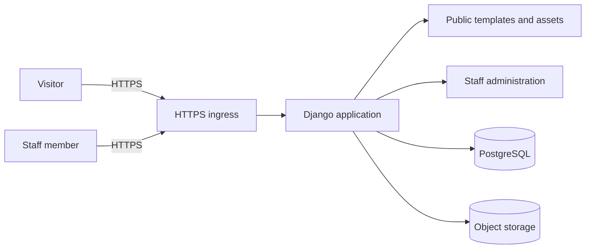

# Publishing website architecture

This proposal uses a public publishing site as the reference project. Visitors can browse articles and topics, search published content, and submit a contact form. Staff can draft, review, publish, and archive articles, manage categories and media, and triage contact submissions.

## Application design

| Layer | Proposed design |
| --- | --- |
| Public frontend | Server-rendered Django templates, responsive CSS, and small JavaScript modules. Provide accessible navigation, paginated search, canonical article URLs, and a sitemap of published pages. |
| Backend | Organize Django into `content`, `inquiries`, and `accounts` apps. Views and forms validate requests, shared publishing logic applies workflow rules, and the ORM handles database access. |
| Administration | Use Django admin for staff accounts, content, taxonomy, media, and submissions. Customize it with review queues, staff-only previews, and explicit publish and archive actions. |
| Storage | PostgreSQL stores users, content, taxonomy, contact submissions, audit events, and media metadata. Object storage holds uploaded files. |

Serve public pages and staff tools on the same origin. The frontend uses ordinary page requests and form submissions, so it can share the backend's routing, validation, and deployment. [Django admin documentation](https://docs.djangoproject.com/en/5.2/ref/contrib/admin/)

## Routes and access

| Route | Behavior |
| --- | --- |
| `/`, `/articles/`, `/articles/<slug>/` | Show published articles and return 404 for drafts and archived articles. |
| `/categories/<slug>/`, `/search/?q=…` | Filter and paginate published articles. Start with PostgreSQL full-text search. |
| `/contact/` | Validate and rate-limit submissions, save them to PostgreSQL, and redirect to a confirmation page. |
| `/admin/` | Require staff sign-in and enforce permissions for each action. |
| `/admin/preview/<id>/` | Require staff content access and serve previews with private, no-store caching. |

Editors can create, edit, and submit their own drafts for review. Publishers can review and publish or archive articles. Support staff can triage inquiries. Administrators manage staff accounts and role assignments. Enforce editor ownership and workflow permissions on the server for both direct and bulk actions. Use CSRF protection, secure session cookies, and MFA for staff. [Django authentication and permissions](https://docs.djangoproject.com/en/5.2/topics/auth/default/)

## Data and publishing

| Record | Fields and relationships |
| --- | --- |
| User | Email, account status, and Django group membership. |
| Article | Unique slug, title, body, author, category, status, and publication timestamp. |
| Category | Unique slug and display name. One category can contain many articles. |
| Media asset | Unique object key, content type, size, alt text, and uploader. Articles can reference multiple assets. |
| Contact submission | Sender details, message, triage status, optional assignee, and timestamps. |
| Audit event | Actor, target record, action, timestamp, and state transition. |

An article moves from draft to review to published to archived. A publisher can return it to draft during review. Each transition checks the current state while holding a row lock and records an audit event in the same database transaction. Every public content query uses the same published-content filter. Keep draft uploads private and grant access through short-lived URLs after checking article permissions. Keep contact details out of application logs and apply a retention policy to submissions.

## Deployment and verification

- Use Docker Compose for local Django and PostgreSQL. Run a production WSGI server behind HTTPS ingress, with a managed PostgreSQL instance on a private network and object storage for uploads.
- Use GitHub Actions for linting, migration checks, and tests against PostgreSQL. Deploy to staging first, run migrations as a single release step, and exercise sign-in, publishing, and contact submission before promoting to production.
- Monitor availability, HTTP errors, and database health. Enable database point-in-time recovery and object versioning, and test restoration of both.
- Verify that draft content and media stay private, editors cannot publish, two concurrent publish attempts create only one transition, and a contact submission survives an application restart. Include keyboard navigation and mobile layout in frontend acceptance checks.

[Django deployment checklist](https://docs.djangoproject.com/en/5.2/howto/deployment/checklist/)
