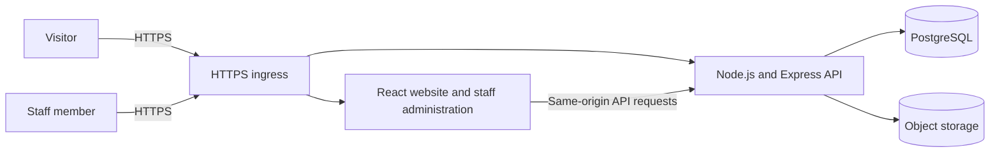

# Publishing website architecture

## Run the application

The React frontend at `apps/web` displays and searches articles from the Express API at `apps/api`. PostgreSQL stores the articles. The sections below describe the target architecture, including staff features planned for later.

Use Node.js 22.12 or newer. From the repository root, install dependencies and start the development database with Docker Compose.

```sh
npm install
docker compose up -d db
```

Copy `apps/api/.env.example` to `apps/api/.env`. If you already have PostgreSQL, you can skip Docker and set `DATABASE_URL` to a development database you own. Once PostgreSQL is accepting connections, create the article table, seed the two sample articles, and start the API.

```sh
npm run db:setup
npm run dev:api
```

In another terminal at the repository root, start the frontend.

```sh
npm run dev
```

Open http://localhost:5173. Vite proxies `/api` requests to the backend on port 3001. Use `npm run build` to build both workspaces and `npm run preview` to serve the frontend build locally while the backend is running.

| Implemented endpoint | Response |
| --- | --- |
| `GET /api/health` | Database connection status |
| `GET /api/articles?q=places` | Published articles matching the optional search term |
| `GET /api/articles/read-the-street` | A published article by slug |

## Project scope

This proposal uses a public publishing site as the reference project. Visitors can browse articles and topics, search published content, and submit a contact form. Staff can draft, review, publish, and archive articles, manage categories and media, and triage contact submissions.

## Application design



| Layer | Proposed design |
| --- | --- |
| Public frontend | React and TypeScript with React Router. Server-render public article and category pages for indexing and social previews. Provide responsive navigation, paginated search, and a sitemap of published pages. |
| Backend | A standalone Node.js and Express REST API written in TypeScript. Organize it into auth, content, media, and inquiries modules. Validate requests at the API boundary and use node-postgres with parameterized SQL and checked-in schema files. |
| Administration | Build an authenticated React dashboard for staff accounts, content, taxonomy, media, and submissions. Include review queues, staff-only previews, and explicit publish and archive actions. |
| Storage | PostgreSQL stores users, content, taxonomy, contact submissions, audit events, and media metadata. Object storage holds uploaded files. |

Use an npm workspaces monorepo with `apps/web` for React, `apps/api` for Express and SQL, and a future `packages/contracts` for request and response schemas. Route `/api/*` to Express and all page requests to the React app behind the same HTTPS origin. The React server calls Express for public page data. [React framework guidance](https://react.dev/learn/creating-a-react-app)

## Routes and access

| Route | Behavior |
| --- | --- |
| `/`, `/articles/`, `/articles/<slug>/` | Show published articles and return 404 for drafts and archived articles. |
| `/categories/<slug>/`, `/search/?q=…` | Filter and paginate published articles. Start with PostgreSQL full-text search. |
| `/contact/` | Validate and rate-limit submissions, save them to PostgreSQL, and redirect to a confirmation page. |
| `/admin/` | Require staff sign-in and enforce permissions for each action. |
| `/admin/preview/<id>/` | Require staff content access and serve previews with private, no-store caching. |

Public endpoints include `GET /api/articles`, `GET /api/articles/:slug`, and `POST /api/inquiries`. Staff endpoints under `/api/admin/` cover editing, previews, publishing, account management, and triage.

Editors can create, edit, and submit their own drafts for review. Publishers can review and publish or archive articles. Support staff can triage inquiries. Administrators manage staff accounts and role assignments. Enforce ownership and permissions in Express for individual and bulk actions. Use staff MFA through an identity provider and store sessions in PostgreSQL. Issue secure HTTP-only cookies and check CSRF tokens on authenticated write requests. [Express production security guidance](https://expressjs.com/en/advanced/best-practice-security.html)

## Data and publishing

| Record | Fields and relationships |
| --- | --- |
| User | Unique identity provider subject, email, account status, and role assignments. |
| Session | Opaque session ID hash, user reference, and expiry. |
| Article | Unique slug, title, body, author, category, status, and publication timestamp. |
| Category | Unique slug and display name. One category can contain many articles. |
| Media asset | Unique object key, content type, size, alt text, and uploader. Articles can reference multiple assets. |
| Contact submission | Sender details, message, triage status, optional assignee, and timestamps. |
| Audit event | Actor, target record, action, timestamp, and state transition. |

An article moves from draft to review to published to archived. A publisher can return it to draft during review. Each transition checks the current state while holding a row lock and records an audit event in the same database transaction. Every public content query uses the same published-content filter. Keep draft uploads private and grant access through short-lived URLs after checking article permissions. Keep contact details out of application logs and apply a retention policy to submissions.

## Deployment and verification

- Use Docker Compose for local React, Express, and PostgreSQL. Deploy the React server and Express API as separate Node.js services behind HTTPS ingress. Use managed PostgreSQL on a private network and object storage for uploads.
- Use GitHub Actions for linting, type checks, builds, and integration tests against PostgreSQL. Deploy to staging first, apply committed migrations as a single release step, and exercise sign-in, publishing, and contact submission before promoting to production.
- Monitor availability, HTTP errors, and database health. Enable database point-in-time recovery and object versioning, and test restoration of both.
- Verify that draft content and media stay private, editors cannot publish, two concurrent publish attempts create only one transition, and a contact submission survives an application restart. Include keyboard navigation and mobile layout in frontend acceptance checks.

[node-postgres query documentation](https://node-postgres.com/features/queries)
